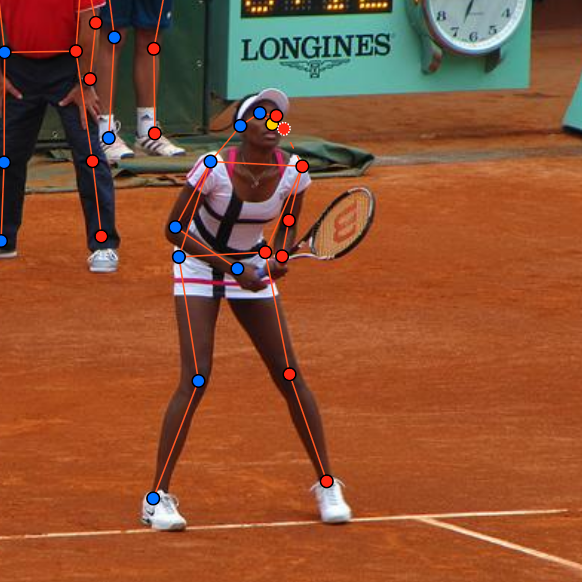
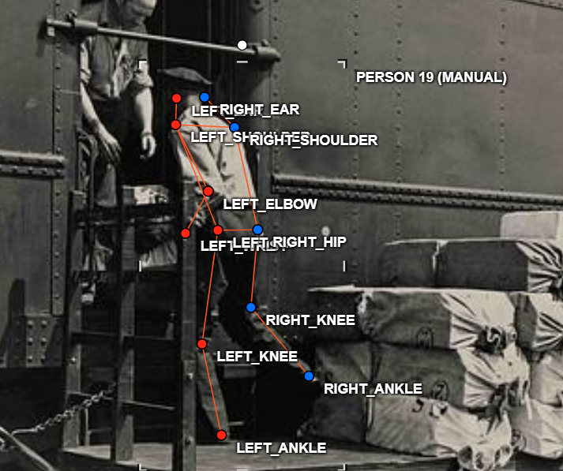
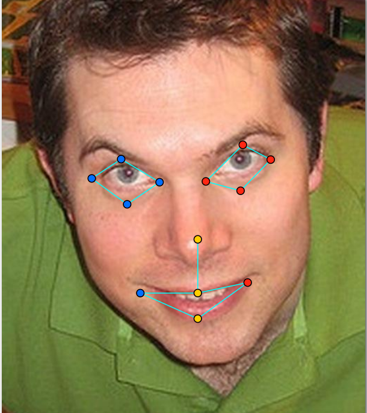
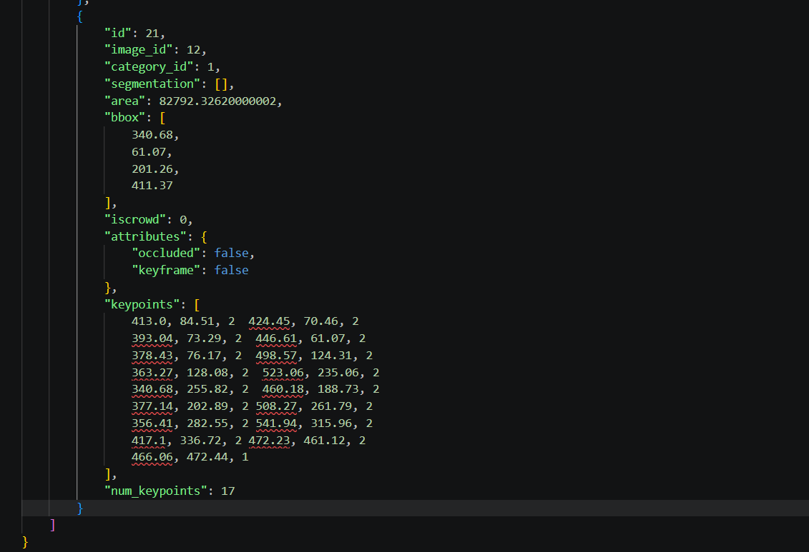

# Báo cáo cá nhân — BuiLeDinhVan-2A202603124

Dữ liệu: 12 ảnh người COCO val2017 (Lin et al., 2014) và 8 ảnh chân dung Wikimedia Commons, chỉ dùng trong lớp.

## 0. Thông tin học viên

- Họ tên: Bùi Lê Đình Văn
- MSSV: 2A202603124
- Email: builedinhvan@gmail.com
- Link repository: https://github.com/DinhVann1703/K5-L2-DAY04-BuiLeDinhVan-2A202603124-KeypointPose
- Phiên bản CVAT (Help → About): 2.82.1
- Máy: hệ điều hành Windows 11 · RAM 8.0 GB · chạy CVAT chế độ lite
- Bộ ảnh (`src/exports/assignment.json` do `lab.py setup` tạo): có
- Giờ bắt đầu: 13:00
- Giờ kết thúc: 17:30

## 1. Kiểm tra label (CP0)

| Label | Kiểu | Số điểm | Tên điểm đúng bảng của lab? | Đúng thứ tự? | Số cạnh |
|---|---|---:|---|---|---:|
| `person` | Skeleton | 17 | Có | Có | 19 |
| `face` | Skeleton | 13 | Có | Có | 12 |

Mẫu `person` dựng theo người quay mặt về camera (các điểm `left_*` nằm bên phải khung mẫu)? Có

Cách đổi cờ `occluded` / `outside` cho **một điểm** trên phiên bản CVAT này (một câu):

Bấm chuột phải trực tiếp lên điểm đó trên khung ảnh (hoặc mở danh sách điểm con của skeleton trong bảng Objects bên phải) và chọn biểu tượng **Switch occluded property** (hình tam giác) để đặt `v = 1` hoặc **Switch outside property** (hình ô vuông) để đặt `v = 0`.

## 2. Số lượng đã gán và thời gian (CP1, CP2)

| Nhóm ảnh | Số ảnh | Số skeleton đã gán | Số người dưới 60 px (không gán) | Số poster / gương / màn hình bỏ qua | Thời gian (phút) |
|---|---:|---:|---:|---:|---:|
| `easy` | 5 | 6 | 0 | 0 | 25 |
| `occluded` | 3 | 4 | 0 | 0 | 22 |
| `back` | 2 | 3 | 0 | 0 | 18 |
| `small` | 1 | 2 | 1 | 0 | 10 |
| `crowd` | 1 | 5 | 3 | 0 | 15 |
| `faces` | 8 | 8 | — | 0 | 24 |

- Số ảnh người đã xong ở mốc phút 105: 8 / 10
- Thời gian thực tế (phút): CP1 90 · CP2 24 · CP3 20
- Ảnh tốn thời gian nhất là ảnh nào, vì sao?

Ảnh `000000043500.jpg` (cùng nhóm `crowd` nhiều người chồng lấn) tốn thời gian nhất vì có 2 người ở tư thế phức tạp: một người đứng trong cửa toa tàu cúi xuống bị thành toa và lan can cầu thang che phần hông và chân dưới, còn một người quay lưng chéo đang bước lên bậc thang bị che khuất hoàn toàn khuôn mặt và cổ tay phải, đòi hỏi phải xác định kỹ hướng xoay cơ thể để tránh nhầm lẫn trái/phải và cân nhắc cờ `v = 1` với `v = 0` cho từng khớp.

## 3. Bảng ca khó (CP1, CP2)

Mỗi điểm bạn phân vân một dòng, nhất là phân vân giữa `v = 1` và `v = 0`, hoặc không chắc hướng người.

| Ảnh | Người / mặt | Điểm | Cờ đã chọn | Phân vân giữa | Lý do chọn |
|---|---|---|---:|---|---|
| `000000043500.jpg` | Người đứng cửa toa tàu (trên) | `right_knee`, `right_ankle` | `v = 1` | `v = 1` và `v = 0` | Bị lan can sắt của cầu thang che chắn nhưng vẫn thấy rõ đường trục ống quần và một phần bàn chân qua khe thang, đủ cơ sở ước lượng chắc chắn vị trí khớp[cite: 18]. |
| `000000043500.jpg` | Người đứng cửa toa tàu (trên) | `left_knee`, `left_ankle` | `v = 0` | `v = 1` và `v = 0` | Chân trái nằm sâu phía sau lan can và khung cửa toa tàu tối màu, bị che khuất hoàn toàn không xác định được vị trí cổ chân nên chuyển sang `outside` (`v = 0`)[cite: 18]. |
| `000000043500.jpg` | Người bước lên thang (dưới) | `nose`, `left_eye`, `right_eye`, `right_wrist` | `v = 0` | `v = 1` và `v = 0` | Nhân vật quay lưng chéo và đội mũ lưỡi trai cúi đầu che khuất hoàn toàn mặt phía trước, tay phải cũng bị thân người che kín nên chọn `v = 0` để tránh đoán bừa tọa độ[cite: 18]. |
| `000000091637.jpg` | Người lớn đứng sau cánh diều | `left_elbow`, `left_knee` | `v = 1` | `v = 1` và `v = 0` | Bị mép cánh diều xanh che ngang nhưng thấy rõ trục cánh tay đưa ra cầm dây diều và bàn chân trái lộ ngay dưới cánh diều nên ước lượng chắc chắn được vị trí khuỷu tay và đầu gối trái[cite: 19]. |
| `000000091637.jpg` | Người lớn đứng sau cánh diều | `right_knee`, `right_ankle` | `v = 0` | `v = 1` và `v = 0` | Toàn bộ chân phải bị cánh diều và em bé đứng phía trước che khuất hoàn toàn từ đùi xuống bàn chân, không có điểm mốc để ước lượng nên đặt `v = 0`[cite: 19]. |
| `000000091637.jpg` | Em bé quay lưng thả diều | `nose`, `left_eye`, `right_eye` | `v = 0` | `v = 1` và `v = 0` | Em bé quay lưng hoàn toàn về phía camera, tóc che kín đầu nên các điểm trên khuôn mặt phía trước không thể xác định được[cite: 19]. |
| `face_256814.jpg` | Khuôn mặt đeo kính râm | Toàn bộ 8 điểm của 2 mắt (`*_eye_*`) | `v = 0` | `v = 1` và `v = 0` | Kính râm bản to, tối đen hoàn toàn (không nhìn xuyên qua thấy tròng mắt hay đường mí) và ảnh bị mờ nhòe, không thể ước lượng chính xác từng pixel mép mí mắt nên đặt `outside` (`v = 0`)[cite: 20]. |

## 4. Bảng tự review (CP3)

Đi từ ảnh cuối về ảnh đầu. 5 ảnh người (ít nhất 2 ảnh `back` hoặc `crowd`) và 3 ảnh mặt. Ít nhất 8 dòng, kể cả dòng `ok`. Ghi lỗi trước, sửa sau.

Mã lỗi dùng đúng một trong: `lr_swap`, `vis_flag`, `position`, `missing`, `extra`, `ok`.

| Ảnh | Người / mặt | Điểm | Mã lỗi | Ghi chú | Đã sửa? |
|---|---|---|---|---|---|
| `face_421231.jpg` | Mặt 1 | `left_eye_upper`, `right_eye_lower` | `position` | Điểm mí mắt ban đầu đặt hơi lệch ra ngoài viền mí trên vùng da xung quanh, đã kéo sát vào đúng mép mí tiếp giáp nhãn cầu[cite: 15]. | Có |
| `face_256814.jpg` | Mặt 1 | Toàn bộ 8 điểm của 2 mắt (`*_eye_*`) | `vis_flag` | Ban đầu để `v = 1` ước lượng theo gọng kính, nhưng khi rà soát thấy tròng kính đen hoàn toàn và ảnh mờ nhòe không đoán chính xác từng pixel mép mí nên đã chuyển toàn bộ 8 điểm mắt sang `outside` (`v = 0`)[cite: 20]. | Có |
| `face_105668.jpg` | Mặt 1 | Toàn bộ 13 điểm | `ok` | Mặt nghiêng nhưng hai mắt, mũi và khóe miệng lộ rõ, đặt đúng mép mí và đúng trái/phải theo người trong ảnh[cite: 10]. | — |
| `000000091637.jpg` | Em bé quay lưng thả diều | `left_shoulder`, `right_shoulder`, `left_hip`, `right_hip` | `lr_swap` | Khi mới thả khung mẫu bị ngược trái/phải do em bé quay lưng hoàn toàn về camera, đã đảo toàn bộ cụm `left_*` sang bên trái ảnh[cite: 19]. | Có |
| `000000091637.jpg` | Người lớn đứng sau cánh diều | `right_knee`, `right_ankle` | `vis_flag` | Ban đầu định để ước lượng `v = 1`, sau khi kiểm tra thấy toàn bộ chân phải bị cánh diều và em bé che khuất hoàn toàn không có mốc tham chiếu nên chuyển sang `outside` (`v = 0`)[cite: 19]. | Có |
| `000000043500.jpg` | Người bước lên thang (dưới) | `nose`, `left_eye`, `right_eye`, `right_ear`, `right_wrist` | `vis_flag` | Đầu quay chéo đội mũ che khuất hoàn toàn vùng mặt phía trước và tay phải bị thân người che kín, đã chuyển sang `outside` (`v = 0`) để tránh đoán bừa tọa độ[cite: 18]. | Có |
| `000000043500.jpg` | Người bước lên thang (dưới) | `left_hip`, `right_hip` | `position` | Đặt hơi cao lên ngang cạp quần, đã hạ xuống đúng vị trí tâm khớp háng nơi đùi gập lại khi bước lên thang[cite: 18]. | Có |
| Ảnh `crowd` | Người nền < 60 px | Không gán | `ok` | Đã kiểm tra chiều cao người ở xa dưới 60 px nên bỏ qua đúng quy định, không gán thừa. | — |

Tổng hợp số lỗi theo mã:

| `lr_swap` | `vis_flag` | `position` | `missing` | `extra` | `ok` |
|---:|---:|---:|---:|---:|---:|
| 1 | 3 | 2 | 0 | 0 | 2 |

Điểm còn phân vân giữa `v = 1` và `v = 0` (ghi cả hai lựa chọn và lý do chọn):

Tại điểm `left_knee` và `left_elbow` của người lớn đứng sau cánh diều trong ảnh `000000091637.jpg`[cite: 19]: phân vân giữa `v = 1` (bị mép cánh diều xanh che khuất một phần nhưng ước lượng chắc chắn vị trí) và `v = 0` (bị che nên bỏ qua không tính loss). Cuối cùng chọn `v = 1` vì cánh tay trái đưa thẳng từ vai ra bàn tay cầm dây diều và bàn chân trái lộ ngay bên dưới cánh diều, tạo thành đường trục giải phẫu thẳng hàng giúp xác định khớp khuỷu và đầu gối trong sai số nhỏ cho phép[cite: 19].

## 5. Kiểm file xuất và kết quả tự kiểm (CP4)

Tự kiểm tay trong file JSON:

| File | Người / mặt kiểm (ảnh, thứ tự) | Số phần tử `keypoints` | Điểm `outside` ra `v = 0`, `occluded` ra `v = 1`? | `num_keypoints` khớp? |
|---|---|---:|---|---|
| `BuiLeDinhVan_persons.zip` | `000000043500.jpg`, người thứ 1[cite: 16] | 51 | Có | Có |
| `BuiLeDinhVan_persons.zip` | `000000091637.jpg`, người thứ 2[cite: 17] | 51 | Có | Có |
| `BuiLeDinhVan_faces.zip` | `face_256814.jpg`, mặt thứ 1[cite: 13] | 39 | Có | Có |

Sau khi xuất, CVAT ghi `occluded` thành `v = 1` và `outside` thành `v = 0`. Tọa độ của điểm `outside` trong file là `0, 0` hay tọa độ cũ? **tọa độ cũ** (CVAT 2.x vẫn giữ nguyên giá trị `(x, y)` trên canvas nhưng đặt cờ `v = 0` để báo hiệu bộ đọc COCO bỏ qua tọa độ này).

Hai job đã chuyển sang completed trên CVAT? Có

Dán phần **TÓM TẮT** in ra từ `src/check_submission.py`:

=== TÓM TẮT KIỂM TRA ===  
----- TÓM TẮT (dán vào báo cáo mục 5) -----  
- File person: BuiLeDinhVan_persons.zip  
  Số ảnh: 12 · số skeleton `person`: 21 · mỗi annotation 51 số  
  Skeleton theo ảnh: 000000043500=2, 000000091637=2, 000000150192=2, 000000162046=1, 000000201702=1, 000000211458=1, 000000241837=1, 000000311300=2, 000000314154=1, 000000381889=3, 000000461389=3, 000000580257=2  
  Cờ v: v=2 258 (72%) · v=1 20 (6%) · v=0 79 (22%)  
  num_keypoints trung bình: 13.2  
- File face: BuiLeDinhVan_faces.zip  
  Số ảnh: 8 · số skeleton `face`: 8 · mỗi annotation 39 số  
  Skeleton theo ảnh: face_105668=1, face_143959=1, face_159828=1, face_256814=1, face_415073=1, face_421231=1, face_85624=1, face_92028=1  
  Cờ v: v=2 95 (91%) · v=1 0 (0%) · v=0 9 (9%)  
  num_keypoints trung bình: 11.9  
- Ghi chú: 88 điểm v = 0 vẫn mang tọa độ cũ (CVAT 2.x xuất như vậy; chuẩn COCO ghi 0, 0). Không phải lỗi: điểm v = 0 bị bỏ qua khihuấn luyện và khi chấm.  
- Số [LỖI]: 0 · số [CẢNH BÁO]: 5  
Kết quả: ĐẠT (đọc lại từng cảnh báo ở trên)  
Các `[CẢNH BÁO]` còn giữ nguyên và lý do:

Lỗi mắc nhiều nhất là `position` (đặt điểm hơi lệch khỏi mép mí mắt hoặc đặt điểm hông hơi cao lên vùng thắt lưng) và `vis_flag` (quên chuyển sang `v = 1` ở các điểm bị che nhẹ như mắt sau kính râm). Ở dự án thật, tôi sẽ thiết lập quy trình zoom cố định tối thiểu 200–300% cho các vùng khớp nhỏ (mắt, cổ tay), bật chế độ hiển thị trực quan phân biệt màu giữa điểm `occluded` và `visible`, đồng thời áp dụng bước kiểm tra chéo (cross-check) ngược từ cuối danh sách ảnh lên đầu.

## 6. Ảnh chụp màn hình

1. Label `person` trong label constructor (đủ 17 điểm có tên):

   

2. Một người quay lưng đã gán, cờ đã đặt:

   

3. Một khuôn mặt đã gán 13 điểm, phóng to vùng mắt:

   

4. Một đoạn JSON xuất của một người:

   

Nguồn ảnh: COCO val2017 / Wikimedia Commons.

## 7. Tự đánh giá

1. Lỗi bạn mắc nhiều nhất hôm nay, và cách bạn sẽ tránh ở dự án thật:

   Lỗi mắc nhiều nhất là `position` (đặt điểm hơi lệch khỏi mép mí mắt hoặc đặt điểm hông hơi cao lên vùng thắt lưng) và `vis_flag` (quên chuyển sang `v = 1` ở các điểm bị che nhẹ như mắt sau kính râm). Ở dự án thật, tôi sẽ thiết lập quy trình zoom cố định tối thiểu 200–300% cho các vùng khớp nhỏ (mắt, cổ tay), bật chế độ hiển thị trực quan phân biệt màu giữa điểm `occluded` và `visible`, đồng thời áp dụng bước kiểm tra chéo (cross-check) ngược từ cuối danh sách ảnh lên đầu.

2. Một quy tắc bạn đề xuất thêm vào guideline (kèm ảnh ví dụ nếu có):

   Đề xuất bổ sung quy tắc định vị **khớp hông (`hip`) theo góc gập giải phẫu** cho các tư thế cúi, ngồi hoặc bước cầu thang (như nhân vật bước lên thang trong ảnh `000000043500.jpg`[cite: 16]): xác định giao điểm giữa đường trục thân trên và đường trục xương đùi thay vì ước lượng theo đường may quần hoặc túi quần, giúp tránh làm biến dạng tỉ lệ chiều dài lưng và đùi.

3. Nhãn của bạn đi vào model ở đâu? Chọn một lỗi bạn đã sửa và nói nó sẽ làm model học sai thế nào (heatmap, trọng số trong loss, hay bước lật ảnh):

   Nhãn keypoint (`x, y, v`) đi trực tiếp vào quá trình sinh **Ground-truth Gaussian Heatmap** (mỗi điểm `v > 0` tạo một đỉnh phân phối chuẩn tại tọa độ `(x, y)`), quyết định **mặt nạ trọng số hàm loss** (chỉ tính loss tại các điểm có `v > 0`, bỏ qua `v = 0`), và tham gia phép biến đổi **Horizontal Flip** (tự động hoán đổi cặp chỉ số `left_*` và `right_*` khi lật ngang ảnh). Nếu tôi không sửa lỗi `lr_swap` ở ảnh em bé quay lưng (`000000091637.jpg`[cite: 17]), khi huấn luyện mô hình sẽ bị xung đột đặc trưng nghiêm trọng: cùng một nửa thân bên trái trên ảnh nhưng lúc thì được học là `left_shoulder`, lúc lại bị gán nhãn ngược thành `right_shoulder` (đặc biệt khi kết hợp lật ảnh ngang), khiến heatmap đầu ra bị phân tán thành hai đỉnh mờ ở cả hai bên vai và làm sụp đổ chỉ số OKS.

## 8. Khó khăn và lỗi kỹ thuật

...

## Bonus (nếu làm)

### B1 — 3 ảnh người khó thêm

| Ảnh | Số skeleton | Số người dưới 60 px | Ca khó nhất |
|---|---:|---:|---|
| | | | |
| | | | |
| | | | |

Kết quả `src/check_submission.py` cho `HoVaTen_bonus_persons.zip`:

```text
(dán ở đây)
```

### B2 — 5 ảnh khuôn mặt đen trắng / hồng ngoại

Ảnh không màu khó hơn ở điểm nào? Kính râm trên ảnh hồng ngoại có còn là `v = 1` không?

...

### B3 — Model so với nhãn của tôi (không tính điểm)

- Demo đã dùng:
- Ảnh đã thử:

1. Model có trả điểm cho khớp bị che, hay khớp ngoài ảnh không? Confidence ở các điểm đó thế nào?

   ...

2. Với người quay lưng, model có đổi trái/phải không?

   ...

3. Bộ điểm của model có giống 17 điểm COCO không?

   ...

## 9. Tài liệu tham khảo và công cụ AI đã dùng

...
